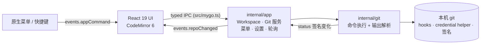

# GitJet

**跑在系统 WebView 里的桌面 Git 客户端。**Go 负责调用你机器上真正的 `git`，React 负责界面；没有 Git 重实现，所以 hooks、filters、credential helper、签名和你的全局配置照常生效。

[](https://github.com/oxyuan/gitjet/actions/workflows/ci.yml)


---

## 它解决什么问题

多数 Git GUI「看」做得很好，「改历史」和「解冲突」却退化成一次性命令行弹窗。GitJet 把这两件事做成一等公民：

- **冲突逐行解决**：三路对比（Ours / Theirs / Base），词级差异，点一行插入结果或整段取我方/对方/两方；最终文件可编辑、可预览，然后直接继续或中止 merge / rebase / cherry-pick / revert。
- **可视化交互式 rebase**：对一段提交逐条保留 / 改写 / 压缩 / fixup / 删除；冲突时暂停，继续即重放剩余计划，中止即回到起点。
- **变更集（Changelist）**：改动按主题分组、切换活动集，按仓库持久化，适合手上同时开三条线。
- **在差异旁边读代码**：源码视图有 LSP 跳转定义/引用、悬停文档与诊断；左侧变更条点一下回滚对应 hunk，当前行显示 blame。

## 架构



- 前端从不拼 git 命令，也不做乐观更新：改完 → `await Git.x()` → 重新读取 → 事件广播刷新。
- 写操作串行执行，避免争用 `index.lock`；读操作不加锁，长推送期间轮询照常。
- 无 cgo，Windows / macOS 都能交叉编译。

## 功能

### 工作区与提交
- 状态实时刷新，终端或编辑器里的改动会自动同步；已暂存 / 未暂存分开呈现
- 按文件或按 hunk 暂存、取消暂存、回滚
- 变更集：新建、重命名、删除、设为活动、移动文件
- 提交面板：全选/反选、提交信息历史、Amend、Sign-off、跳过钩子、自定义作者、提交并推送
- 未跟踪文件：加入版本控制、删除、写入 `.gitignore`
- 贮藏：创建/列表/应用/弹出/删除（可含未跟踪文件、保留暂存区）；贮藏详情逐文件看差异，可恢复到新分支
- 破坏性操作前自动贮藏本地改动（`gitjet: before <action>`），完成后 `stash pop --index` 还原，失败则保留并告知

### 冲突与历史重写
- 并排对比 Ours / Theirs（含词级差异）：插入单行、整段取边、查看共同祖先、编辑最终文件、预览结果
- 冲突汇总对话框：一次列出全部冲突文件，批量采用我方/对方、批量标记已解决
- merge / rebase / cherry-pick / revert / am 的继续与中止
- 编辑历史：逐条 reword / squash / fixup / drop；计划按顺序写到 `<git dir>/gitjet-rewrite-plan.json`，可从中断处继续

### 日志与历史
- 多 lane 提交图、合并线、分支/标签标记（排在提交信息之后，只占自己需要的宽度）
- 时间列到秒；今天的提交显示为「今天 09:41:26」
- 按当前分支 / 全部分支 / 指定分支过滤；全文搜索；按路径或源码行查看文件历史
- 提交详情：作者、时间、完整信息、引用、文件列表与行数统计，可直接打开该版本源码
- 提交操作：检出、新建分支/标签、Cherry-Pick、Revert、Soft/Mixed/Hard Reset、复制哈希
- 多选提交（⌘/Ctrl 点击与 Shift 连选）后批量摘取 / 批量还原 / 复制哈希
- 分支右键：列出与 HEAD 之间的差异文件
- 文件历史与作者标注（Blame）

### 差异查看器
- 并排 / 统一排版，长行自动换行，上/下一处变更，忽略空白
- 默认展示整个文件、只高亮改动；上下文行数设成 1–100 则只保留改动附近窗口，其余折叠
- 两侧语法高亮与源码视图共用一套调色板（`src/highlight.ts`）
- 在差异里直接暂存、取消暂存、回滚单个 hunk 或整个文件
- 识别二进制、超大文件、重命名与复制

### 源码阅读与跳转
- CodeMirror 6 只读查看工作区 / 索引 / 任意提交中的文件，30+ 语言语法按需加载
- 编辑器标注：左侧变更条对应 git 的 hunk，点击即可回滚该段修改（带确认）；当前行尾部显示 blame（作者、提交、摘要、时间），未提交的行单独标记
- 行号 Git 菜单：点击或右键行号显示该行的提交、作者、时间与摘要；可查看该提交在此文件中的全部差异、按行过滤历史（`git log -L`）或复制哈希。工作区、索引与任意提交的源码都是同一个视图，blame 按当前版本计算
- 行注解（Annotate）：在同一菜单里开关「使用 Git Blame 注解」，在行号左侧逐行展开提交日期与作者，并按提交着色；点击任意注解行可打开同一菜单。差异视图的两侧行号也提供同一菜单与注解列（左侧按父提交、右侧按新版本）
- 源码 ↔ 差异一键切换；源码与差异的路径旁可复制绝对路径、仓库相对路径、文件名（可带光标行号）或终端转义路径
- `⌘/Ctrl+B`（`F12`）跳定义、`⌘/Ctrl+Shift+B`（`Shift+F12`）列引用、`⌘/Ctrl+点击` 同效，悬停看文档；检测到 `gopls`、`clangd`、`typescript-language-server`、`rust-analyzer`、`jdtls`、`pyright-langserver` 时走 LSP（含诊断波浪线），否则退回 `git grep` 全文搜索，并按语言规则区分声明与引用
- 文件视图（`⌘/Ctrl+Shift+E`）：整个工作区目录树（含未跟踪文件），按路径子序列筛选，点开即源码
- 快速打开：`⌘/Ctrl+P` 搜文件名/路径片段；输入两个字以上时同时搜提交信息与作者
- 差异、源码、冲突、提交详情以标签页并存，可中键关闭

### 分支、远端与仓库工具
- 分支弹窗：本地/远程分支、标签、上游跟踪、领先/落后、搜索
- 清理分支：已合并到当前分支的、上游已删除的本地分支，勾选后删除
- 工作树：列出、新建（可同时建分支）、在新窗口打开、移除、清理失效项
- 子模块状态与初始化/更新；Git LFS 安装状态与跟踪文件；浅克隆补全历史
- Fetch / Pull（merge 或 rebase、autostash、prune、tags）
- Push 前确认面板：本地→远程走向、本次提交列表（可展开看文件）、全部变更文件；远程分支不存在时标为「新建分支」
- 预览里可直接改远程分支名（走 refspec，本地分支名不变），预览即时刷新并标出「新建分支」
- 支持 set-upstream、`--force-with-lease`、`--force-if-includes`、tags、dry run；远端已分叉时明确警告；记住最近推送目标
- 预览里的变更文件可直接点开：并排/统一差异、折行、忽略空白与改动跳转，也可切到「文件」查看该版本全文
- 工具栏同步提示：有未推送提交时 Push 显示绿色圆点，远端有新提交时 Fetch 与 Pull 显示绿色圆点；悬停标题给出待处理的提交数

### 其他
- 控制台工具有两个视图：「日志」默认展示软件执行过的操作（pull、push、提交、命令行……）及其完整命令与输出；「控制台」是原来的命令行，`git` 是隐含前缀，输入 `status` 就是 `git status`；`!` 开头按原样运行其他程序（`!ls -la`）。Tab 补全子命令/选项/引用，带命令历史
- 控制台的清除只是清空当前视图（记住清除时间点，新记录继续出现），记录本身追加写入 `<配置目录>/logs/<仓库名>-<摘要>.jsonl`；工具栏的日志文件按钮直接在文件管理器里定位它
- 每个操作都会回显实际执行的命令（如 `$ git fetch --progress --all --prune --tags`），可一键复制；输出实时流式显示
- 左上四个工具窗口（提交 / 分支 / 文件 / 控制台）的顺序在「设置 → 通用」里用上下箭头调整，立即生效并记住
- 设置：界面语言、主题、字号（整窗缩放）、工具窗口顺序、Git 可执行文件路径与检测、diff 上下文行数、空白处理、显示忽略文件、自动 fetch、更新策略、危险操作确认
- 最近仓库列表，启动时恢复上次打开的仓库；原生文件夹选择、系统剪贴板、在文件管理器中显示

## 快速开始

目前没有预编译发行版，从源码构建即可（一条命令）：

```sh
bun install && bun run build            # 产物在 build/<os>-<arch>/
```

|依赖|说明|
|---|---|
|Go 1.27.3+|构建后端|
|Bun|包管理、构建、前端测试|
|Git 2.23+|运行时调用，需要 `git switch`；认证沿用系统 SSH agent / credential helper|
|WebView2 Runtime|仅 Windows，Win11 自带，[下载](https://developer.microsoft.com/microsoft-edge/webview2/)|

macOS 产出 `.app` / `.dmg`，Windows 产出 `GitJet.exe` 与安装程序（交叉构建安装程序需要本机有 NSIS，没有则只出 `.exe`，如 `build/windows-amd64/GitJet.exe`）。

指定平台：

```sh
bun run build -- -platform darwin/universal,windows/amd64
```

## 开发

```sh
bun run dev          # mygo dev：生成绑定 + Vite + 原生窗口（热更新）

bun run typecheck    # tsc --noEmit
bun run test:web     # 前端纯逻辑单测（bun test）
bun run generate     # 改过绑定类型后重新生成 src/mygo.ts
go test ./... && go vet ./...
```

提交前跑一遍 CI 同款门槛：

```sh
go test ./... && go vet ./... && bun run typecheck && bun run test:web && bun run build:web
```

## 快捷键

| 快捷键 | 操作 |
| --- | --- |
| `⌘/Ctrl+O` | 打开仓库 |
| `⌘/Ctrl+P` | 快速打开文件 / 提交 |
| `⌘/Ctrl+R` | 刷新 |
| `⌘/Ctrl+K` | 聚焦提交信息 |
| `⌘/Ctrl+Enter` | Commit |
| `⌘/Ctrl+Shift+K` | Push |
| `⌘/Ctrl+T` | Pull |
| `⌘/Ctrl+Shift+S` | Stash |
| ``⌘/Ctrl+Shift+` `` | 分支弹窗 |
| `⌘/Ctrl+,` | 设置 |
| `⌘/Ctrl+B` / `⌘/Ctrl+Shift+B` | 跳到定义 / 列出引用（源码视图） |
| `⌘/Ctrl+点击` / `⌘/Ctrl+Alt+点击` | 跳到定义 / 列出引用 |
| `⌘/Ctrl+9` / `⌘/Ctrl+Shift+9` / `⌘/Ctrl+Shift+E` | 提交 / 控制台 / 文件 工具窗口 |

## 目录结构

```
main.go                 入口 → internal/app.Run
internal/app/           窗口、菜单、事件、绑定服务、设置、仓库元数据、LSP 桥
internal/git/           git 执行与解析：状态、差异、日志、动作、blame、控制台、
                        历史重写（rewrite.go）、工作树/子模块/LFS（repo_extra.go）
internal/lsp/           按仓库标记探测语言服务器
src/                    React 前端
  App.tsx               应用状态、命令分发、工具窗口与编辑器标签页
  CommitPanel.tsx       变更列表、变更集与提交
  DiffView.tsx          并排/统一差异、行号 blame 菜单与注解列
  ConflictView.tsx      三路冲突解决
  SourceView.tsx        源码视图外壳：标题、工具栏、二进制/空文件状态
  SourceEditor.tsx      CodeMirror 挂载、变更条、blame、跳转接线
  SourceTree.tsx        文件视图：工作区目录树 + 子序列筛选
  editor.ts             CodeMirror 配置：主题、按需语法、装饰
  lsp.ts                LSP 客户端（IPC 传输，无 socket/worker）
  syntax.ts / highlight.ts  Lezer 语法树 → 逐行 token；编辑器与差异共用的调色板
  LogDock.tsx           提交图与提交详情
  BranchList.tsx / RepoExtrasDialog.tsx / EditHistoryDialog.tsx / SymbolPanel.tsx / QuickOpen.tsx
  *.ts 纯逻辑模块         diff / graph / merge / branches / changes / annotate / symbols /
                        paths / explorer / tabs（各带测试）
  mygo.ts               由 Go 服务生成的类型安全客户端（勿手改）
```

## 已知限制

- 不内置 Git：认证走系统 SSH agent 或 credential helper；Git 版本过低会直接提示。
- 语言服务器不随应用打包，只从 `PATH` 找；没有服务器时跳转退化为文本匹配。
- 编辑历史的计划按时间顺序执行，列表内不能拖动重排，也暂不支持 `edit`（停下来改内容）。
- 子模块与 LFS 是「只读状态 + 更新动作」，不能新增/删除子模块或编辑 LFS 跟踪规则。
- 无自动更新；构建产物未签名（macOS 为 ad-hoc 签名）。
