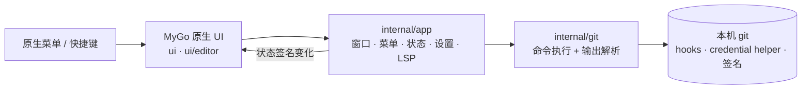

# GitJet

**用 Go 和 MyGo 原生 UI 写的桌面 Git 客户端。** 窗口由 MyGo 直接绘制，没有 WebView；Go 调用你机器上真正的 `git`，hooks、filters、credential helper、签名和全局配置照常生效。

[](https://github.com/oxyuan/gitjet/actions/workflows/ci.yml)


## 功能

### 工作区与提交
- 状态每 1.5 秒刷新，外部改动自动同步；已暂存 / 未暂存 / 未跟踪 / 冲突分开展示
- 按文件、hunk 或选中行暂存、取消暂存、回滚；未跟踪文件可「暂存但不含内容」
- 提交面板：勾选要提交的文件、提交信息历史与 72 列重排、Amend、Sign-off、跳过钩子、自定义作者、允许空提交、GPG 签名
- 「只提交选中的更改」使用临时索引，不改变其他文件原有的暂存状态
- 提交前检查：CRLF、超大文件、Windows 不可检出的文件名、分离 HEAD；受保护分支提交前确认
- 撤销上次提交、固定提交（`fixup!` / `squash!`）、提交并推送、提交并 Rebase
- 变更集：新建、重命名、删除、设为活动、把文件移到其他变更集
- 贮藏：创建、应用、弹出、删除、清空、查看文件、恢复到新分支
- 搁置（Shelf）、补丁生成/应用、本地历史（按内容去重，可预览、恢复）
- 破坏性操作前自动 `stash`，完成后恢复

### 差异与源码
- 并排 / 统一 diff，自动换行，忽略空白，上/下一块变更，上下文折叠
- 在 diff 里按文件、hunk、选中行暂存、取消暂存、回滚；二进制与超大文件单独提示
- 图片并排或叠加对照，带透明度滑块；`git difftool` 一键交给外部工具
- 源码视图编辑工作区文件，索引与历史版本只读；`⌘/Ctrl+S` 保存
- 左侧变更条对应 hunk，点击回滚；行号菜单显示 blame，可查看提交、文件版本或按行历史
- Blame 注解列可开关，自动读取 `.git-blame-ignore-revs`，可忽略空白改动
- LSP：自动探测并启动 gopls、clangd、typescript-language-server、rust-analyzer、jdtls、pyright，提供补全、悬停、跳转定义与诊断；没有服务器时退回 `git grep`
- 文件树、快速打开（文件名/路径，输入两个字以上同时搜提交信息与作者）
- 源码与 diff 之间切换，复制绝对路径、仓库相对路径、`@路径`、带行号路径或终端转义路径

### 分支、历史与远端
- 本地/远程分支、最近检出置顶、上游领先/落后、标签
- 检出并更新、更新所选分支、重置到远端、比较、新建/重命名/删除分支、设置上游
- 清理已合并或上游已删除的分支
- 工作树：列出、新建、锁定/解锁、打开、移除、清理
- 子模块：状态、添加、初始化更新、同步；Git LFS：跟踪/取消跟踪、拉取；浅克隆补全历史
- Fetch / Pull / Push：prune、tags、autostash、rebase、ff-only/no-ff、squash
- Push 预览显示目标分支、提交与文件；可改远程分支名（refspec），支持 set-upstream、force-with-lease、force-if-includes、tags、dry run
- 提交图按 lane 绘制合并线；多选提交后批量 cherry-pick / revert / 复制哈希
- 日志搜索、作者、起止日期、大小写、正则、文件历史（`--follow`）、按行历史（`git log -L`）
- 提交详情：文件列表、统计、分支/标签、检出、重置、cherry-pick、revert、标签、fixup/squash
- 编辑历史：pick / reword / squash / fixup / drop、上下重排，冲突后继续或中止

### 冲突
- 每个冲突在独立窗口打开，三栏（本地 / 结果 / 远程）同时显示
- 结果区按块选择接受左/右/忽略；可编辑后直接保存；未解决块保留 Git 标记
- 冲突汇总：逐文件接受任一侧、解决简单冲突、应用并完成
- `F7` / `Shift+F7` 在变更块间跳转

### 其他
- 控制台：执行 `git` 命令或 `!` 开头的任意程序，输出流式显示；「操作」页显示命令与输出日志
- 设置：语言、主题、界面缩放、Git 路径、SSH 命令、Fetch 标签策略、diff 上下文、空白处理、自动 Fetch、提交检查、提交模板、受保护分支、危险操作确认
- 最近仓库、原生文件夹选择、系统剪贴板、在文件管理器中显示
- 中英文界面，跟随系统语言；浅色/深色主题跟随系统或手动选择
- 每个窗口是独立进程，可同时打开多个仓库

## 构建

需要 Go 1.27.3+ 和本机 `git` 2.23+（需要 `git switch`）。

```sh
go run .                    # 直接运行
go tool mygo build          # 打包到 build/<os>-<arch>/
go test ./... && go vet ./...   # 测试与静态检查
```

macOS 产出 `.app` / `.dmg`，Windows 产出 `.exe` / 安装程序，Linux 产出二进制。无 cgo，可交叉编译。

## 架构



- `internal/git` 是唯一执行 git 的包；每个方法把输出解析成普通结构体。
- `internal/app` 持有窗口、仓库状态、轮询、设置与 LSP 客户端；所有 UI 状态都在主线程，耗时操作在 goroutine 完成后回到主线程。
- 写操作串行执行，避免争用 `index.lock`；读操作不加锁，长推送期间轮询照常。
- 无 cgo：平台代码使用 purego / `syscall`，按 GOOS 分文件。

| 目录 | 内容 |
|---|---|
| `internal/git/` | 状态、diff、日志、动作、blame、rewrite、worktree/submodule/LFS、console |
| `internal/app/` | `ui_*.go` 原生视图与对话框、`service.go` 服务层、`settings.go`、`lsp.go`、`journal.go` |
| `internal/lsp/` | 语言服务器探测与消息分帧 |
| `internal/proc/` | Windows 隐藏控制台窗口 |
| `resources/` | 应用图标 |
| `mygo.json` | 打包配置 |

## 快捷键

| 快捷键 | 操作 |
| --- | --- |
| `⌘/Ctrl+O` | 打开仓库 |
| `⌘/Ctrl+P` | 快速打开文件 / 提交 |
| `⌘/Ctrl+R` | 刷新 |
| `⌘/Ctrl+K` | 提交 |
| `⌘/Ctrl+Shift+K` | Push |
| `⌘/Ctrl+T` | Pull |
| `⌘/Ctrl+Shift+S` | Stash |
| `⌘/Ctrl+,` | 设置 |
| `⌘/Ctrl+S` | 保存当前源码 |
| `⌘/Ctrl+F` | 编辑器内查找 / 替换 |
| `⌘/Ctrl+9` / `⌘/Ctrl+0` | 提交 / 分支工具窗口 |
| `⌘/Ctrl+Shift+E` | 文件工具窗口 |
| `⌘/Ctrl+Shift+9` | 控制台 |
| `F12` / `⌘/Ctrl+点击` | 跳转到定义（编辑器） |

## 已知限制

- 不内置 Git，也不内置语言服务器；它们从 `PATH` 查找。
- 原生编辑器内置 32 种常用语言；更少见的文件按纯文本显示。
- 没有自动更新；构建产物未签名（macOS 为 ad-hoc 签名）。
