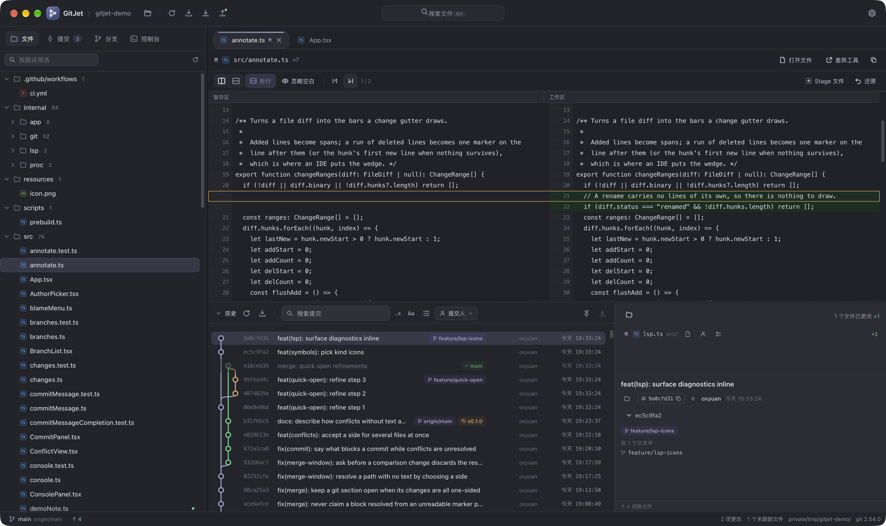
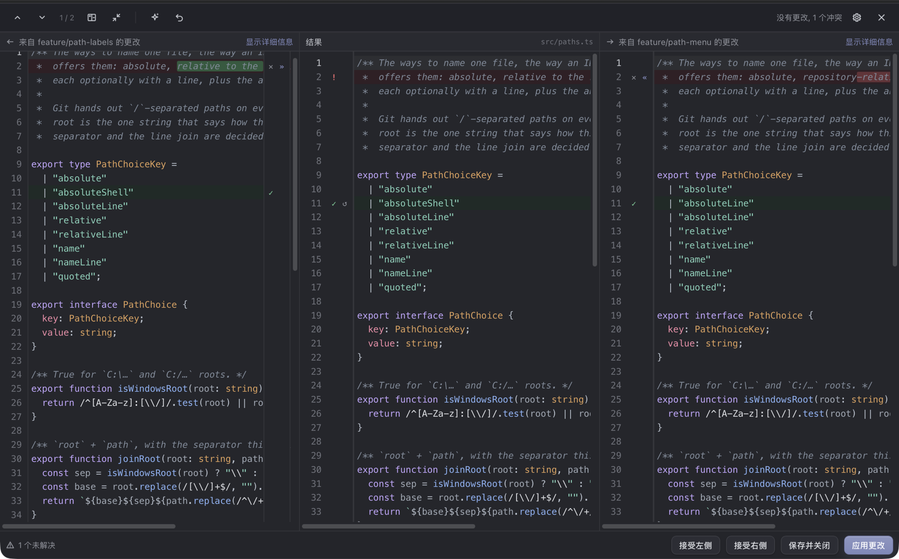
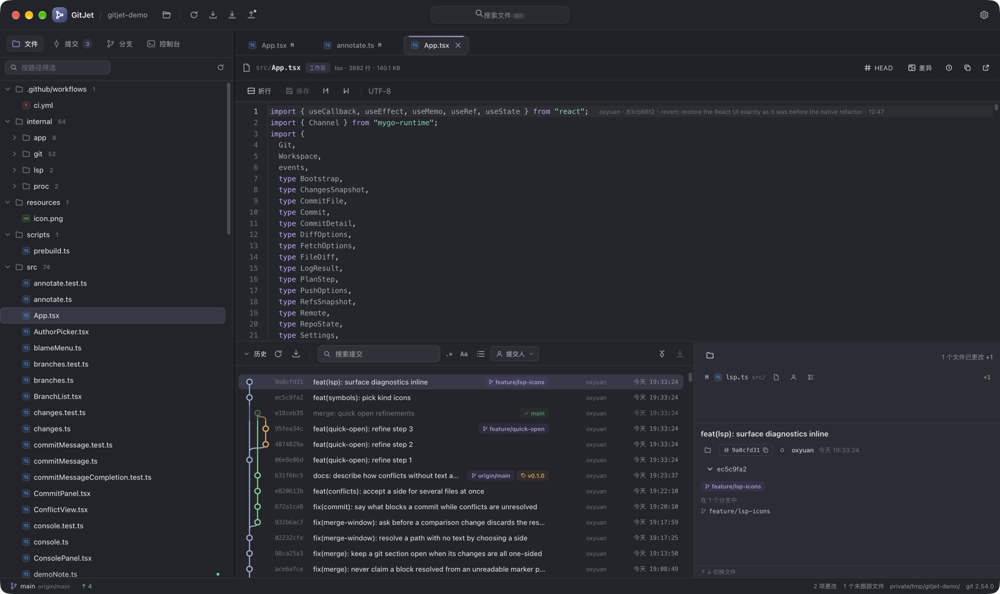

<div align="center">


# GitJet

**把真正的 `git` 装进一个好看的桌面界面。**

Go 调用你机器上的 git，React 画界面。hooks、filters、credential helper、签名和你的全局配置照常生效——因为它从不重写 git。

[](https://github.com/oxyuan/gitjet/actions/workflows/ci.yml)




</div>

## ✨ 亮点

- 🧩 **三栏冲突解决** —— 本地 / 结果 / 远程同屏，逐块接受或忽略，已应用的块随时可以还原，结果区可直接编辑。
- 🕰️ **可视化改历史** —— pick / reword / squash / fixup / drop / edit / exec / break，冲突时暂停，可继续或中止。
- 🗂️ **变更集** —— 改动按主题分组，一个仓库同时开几条线。
- 🔍 **在差异旁读代码** —— LSP 跳转与悬停文档、行内 blame，点变更条回滚 hunk。
- 🧬 **原生 git** —— 每条命令都是本机的 git，行为和终端一致。
- 🪶 **轻** —— 系统 WebView，无 Electron；无 cgo，Windows / macOS 交叉编译。

## 📸 界面

**冲突解决**：三栏合并、块级接受 / 忽略、同步滚动。



**源码阅读**：目录树、可编辑源码、行内 blame 与 LSP。



## 🧰 功能一览

- 🗂️ **工作区** —— 按文件、hunk 或选中行暂存与回滚；HEAD / 暂存区 / 工作区三侧同屏；变更集；贮藏、补丁、搁置（含未跟踪文件与暂存状态）、文件与仓库级本地历史。
- ✍️ **提交** —— amend、只提交暂存区 / 选中更改 / 全部更改、sign-off、GPG 与签名校验、模板、身份与 pinentry 检查、撤销提交、任意提交 amend 与按提交信息 fixup、提交前 Review。
- 🌿 **分支与远端** —— 检出 / 更新、标签、清理已合并分支、工作树、子模块、LFS、钩子、push 预览与 refspec。
- 🕰️ **历史** —— 多 lane 提交图、多分支过滤与搜索、显示实际 git 命令、任意比较、cherry-pick / revert / reset、文件历史、blame。
- 🔀 **冲突与重写** —— 三栏合并与内存三方合并（按 git 的 diff3 算法，不触碰工作区即可暂存结果）；merge / rebase / cherry-pick / revert 的继续、跳过与中止；交互式 rebase。
- 👀 **阅读** —— 并排 / 统一差异、差异内查找、工作区与 HEAD 共用标签页、定位打开的文件、图片对照、可编辑源码、声明 / 实现 / 类型声明跳转、按文件分组并带代码预览的引用列表、快速打开、多标签。
- 🖥️ **工具** —— 控制台与操作日志、通知中心（本次会话的历史提示）、快捷键、主题与语言、最近仓库、系统集成。

## 🚀 快速开始

目前没有预编译发行版，从源码构建：

```sh
bun install && bun run build     # 产物在 build/<os>-<arch>/
```

| 依赖 | 说明 |
| --- | --- |
| Go 1.27.3+ | 构建后端 |
| Bun | 包管理、构建、前端测试 |
| Git 2.23+ | 运行时调用，认证沿用系统 SSH agent / credential helper |
| WebView2 | 仅 Windows，Win11 自带，[下载](https://developer.microsoft.com/microsoft-edge/webview2/) |

macOS 产出 `.app` / `.dmg`，Windows 产出 `GitJet.exe` 与安装程序（交叉构建安装程序需本机有 NSIS）。指定平台：

```sh
bun run build -- -platform darwin/universal,windows/amd64
```

## 🧑‍💻 开发

```sh
bun run dev          # 生成绑定 + Vite + 原生窗口（热更新）
bun run typecheck    # tsc --noEmit
bun run test:web     # 前端纯逻辑单测
go test ./... && go vet ./...
```

提交前跑一遍 CI 同款门槛：

```sh
go test ./... && go vet ./... && bun run typecheck && bun run test:web && bun run build:web
```

## ⌨️ 常用快捷键

| 快捷键 | 操作 |
| --- | --- |
| `⌘/Ctrl+O` | 打开仓库 |
| `⌘/Ctrl+P` | 快速打开文件 / 提交 |
| `⌘/Ctrl+K` | 聚焦提交信息 |
| `⌘/Ctrl+Enter` | Commit |
| `⌘/Ctrl+Shift+K` | Push |
| `⌘/Ctrl+T` | Pull |
| `⌘/Ctrl+Shift+S` | Stash |
| `` ⌘/Ctrl+Shift+` `` | 分支弹窗 |
| `⌘/Ctrl+9` / `⌘/Ctrl+0` | 提交 / 分支工具窗口 |
| `⌘/Ctrl+B` / `F12` | 跳到声明；光标就在声明上时列出引用（多个目标时选择） |
| `⌘/Ctrl+Click` | 同上：跳到声明，或查看该声明的引用 |
| `⌘/Ctrl+Alt+B` | 跳到实现 |
| `Ctrl+Shift+B` | 跳到类型声明（macOS 为 ⌃⇧B） |
| `⌘/Ctrl+Shift+Click` | 跳到类型声明 |
| `⌥F7` / `⌘/Ctrl+Alt+F7` / `⇧F12` | 查找引用（按文件分组、可筛选；只有一处时直接打开） |
| `⌘/Ctrl+Alt+←` / `⌘/Ctrl+[` | 导航后退 |
| `⌘/Ctrl+Alt+→` / `⌘/Ctrl+]` | 导航前进 |
| `⌘/Ctrl+S` | 保存源码 / 应用冲突结果 |
| `⌘/Ctrl+F` | 在差异中查找 |
| `⌘/Ctrl+Space` | 代码补全（语言服务器或文件内单词） |
| `⌘/Ctrl+/` | 行注释；`⌘/Ctrl+Shift+/` 块注释 |
| `⌘/Ctrl+D` | 复制当前行或所选内容 |
| `⌘⌫` / `Ctrl+Y` | 删除当前行 |
| `⌘/Ctrl+Shift+↑` / `↓` | 上移 / 下移语句 |
| `⌥↑` / `⌥↓` | 扩展 / 缩小选区（IDEA 的 Extend / Shrink Selection） |
| `⌘L` / `Ctrl+G` | 跳转到行（支持 `行:列`、`+n`、`n%`） |
| `⌘/Ctrl+-` / `=` | 折叠 / 展开当前代码块 |
| `⌘/Ctrl+Shift+-` / `=` | 全部折叠 / 展开 |
| `⌘/Ctrl+.` | 切换当前代码块的折叠 |
| `⌘/Ctrl+Alt+L` | 重新格式化（需要语言服务器） |
| `Shift+F6` | 重命名符号（需要语言服务器） |
| `⌥Click` | 添加多光标 |
| `F7` / `Shift+F7` | 下一处 / 上一处变更（差异与冲突视图） |

## 📌 说明

- 不内置 Git，版本过低会直接提示。
- 语言服务器不随应用打包，只从 `PATH` 找；没有服务器时用 `classifyHits` 读取 `git grep` 的结果，调用处仍跳到声明，在声明上则列出引用。
- 构建产物未签名（macOS 为 ad-hoc），没有自动更新。
